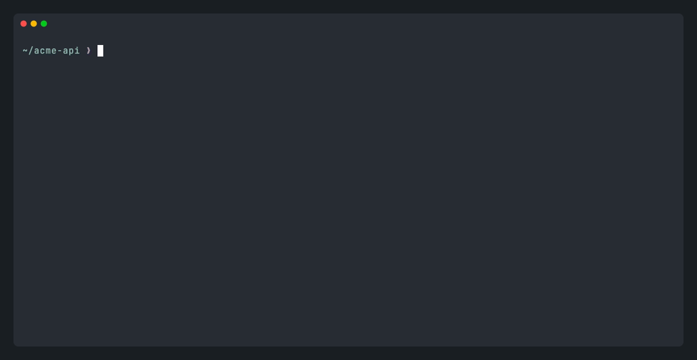
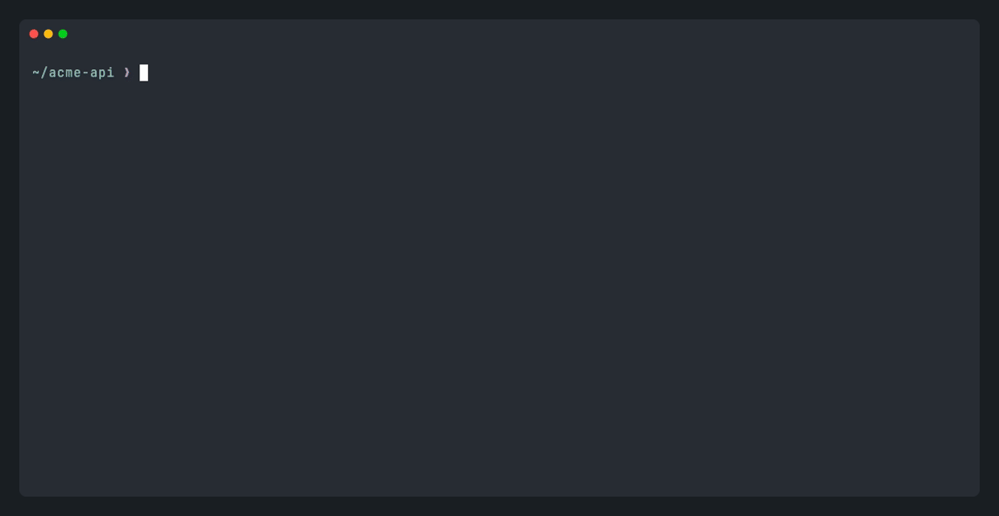
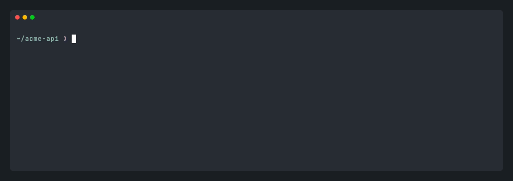

# claude-code-mods

Small mods for Claude Code: a copy link under every code block, `/sid` to copy
the session ID, the notes that focus mode hides, and two for the prompt cache
(a live countdown to when it goes cold, and `/keep-warm` to stop it going cold
while you're away).

Each one is a separate plugin, so install only the ones you want.

## Install

At the prompt of a Claude Code session in a terminal:

```
/plugin install copy-code --marketplace minimondocode/claude-code-mods
```

Answer `y` to add the marketplace, then pick a scope (user installs it for
every session). Swap `copy-code` for any mod below. From a shell:

```
claude plugin install copy-code --marketplace minimondocode/claude-code-mods
```

In the desktop app, where `/plugin` doesn't run: click **+** next to the prompt
box, then **Plugins**, **Add marketplace** with `minimondocode/claude-code-mods`,
then **Add plugin**.

## The mods

### copy-code

A small `⧉` copy link under every fenced code block Claude writes. It copies the
code exactly as written, without the terminal's wrapping or indentation.
`/copycode [n]` copies block `n` of the last reply from the keyboard (the last
block by default). It also asks Claude to put anything you're meant to copy, such as
commands, prompts and config, in its own code block.


### copy-session-id

`/sid` copies the current session ID to the clipboard, for `claude -r` or a bug
report. Nothing goes into the conversation: no prompt, no output, no tokens.



### focus-notes

In focus view, Claude Code shows only the final answer. This mod shows the
short notes Claude writes between tool calls in a band above the prompt
("Claude, mid-turn"), so you can follow along without leaving focus view.
**Hide** closes the band until your next prompt.



### keep-warm

The prompt cache expires an hour after the last request, and the next message
after that costs a full re-read of the conversation. `/keep-warm on` sends a
tiny "reply ok" request 55 minutes after the last real one, so the cache stays
warm while you're away. It stops after a number of idle pings in a row (6 by
default, `/keep-warm on 3` for 3), and real activity resets the count.
`/keep-warm status` shows the next ping, and `/keep-warm off` stops it. Each
ping is a real (cached, so cheap) request.


### cache-countdown

A countdown under the prompt to when the prompt cache goes cold (`⏱ 59:58`,
then `⏱ cold`), restarting with each request. It also writes the time of the
last request to `~/.claude/state/cache-clock/<session id>`, so your own status
line script can show the countdown instead. If yours does, turn off the mod's
own display with the **Show the countdown** option in `/config`.



## Developing

Each mod is a folder under `plugins/` with a hooks module in `hooks/`. To try
a change, start a session with that folder loaded:

```
claude --plugin-dir plugins/copy-code
```

`claude plugin validate plugins/<mod>` checks one, and
`claude plugin test plugins/<mod>` runs its tests.

The GIFs are recorded with [vhs](https://github.com/charmbracelet/vhs) from the
tapes in `docs/demo/`: `docs/demo/record.sh [mod ...]` runs a real Claude Code
session for each, in a copy of the dummy project in `docs/demo/acme-api/`, with
only that mod loaded.

## License

MIT
